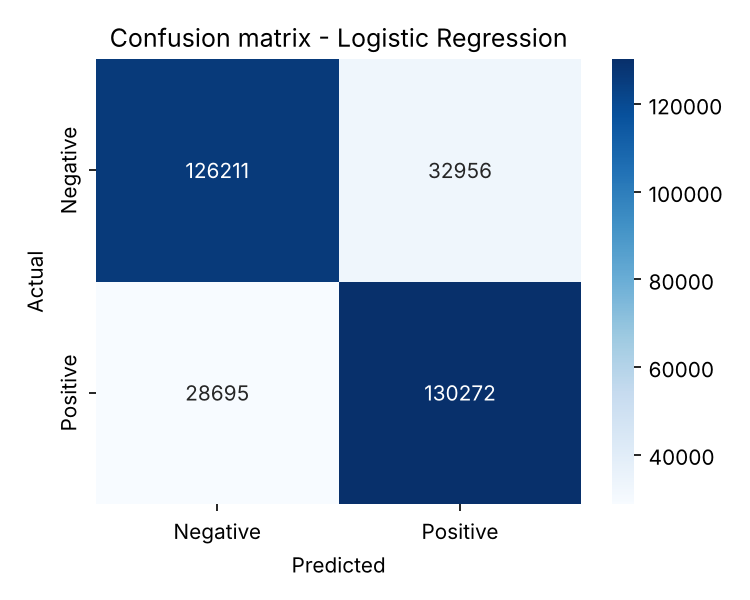

# Twitter Sentiment Analysis with NLP

An end-to-end Natural Language Processing project for classifying the sentiment of tweets using the Sentiment140 dataset.

The project applies text preprocessing and machine learning techniques to predict whether a tweet expresses a negative or positive sentiment, and exposes the trained model through a REST API and a web interface.

## Overview

Social media contains a large amount of public opinion data. This project explores how Natural Language Processing can be used to transform raw tweets into useful sentiment insights.

It covers the whole life of a machine learning project: data preparation, model comparison, error analysis, a REST API, a web interface, automated tests, continuous integration and Docker.

## Results

Trained on the full Sentiment140 dataset (1,590,670 tweets after cleaning; 80% for training, 20% for testing, stratified, `random_state=42`):

| Model | Accuracy | Precision | Recall | F1-score |
|-------|---------:|----------:|-------:|---------:|
| **Logistic Regression** (selected) | **80.6%** | 79.8% | 81.9% | **80.9%** |
| Linear SVM | 80.0% | 79.1% | 81.5% | 80.3% |
| Multinomial Naive Bayes | 78.7% | 78.7% | 78.6% | 78.7% |

All models use the same TF-IDF features (unigrams and bigrams, up to 100,000 terms). Results are saved in `models/metrics.json`, and the confusion matrix is in `reports/confusion_matrix.png`.



### What the error analysis showed

The full report is in [`reports/error_analysis.md`](reports/error_analysis.md). The main findings:

- **The model knows when it is unsure.** When its confidence is above 90%, it is wrong only 4.9% of the time. When it is between 50% and 60%, it is wrong 44.2% of the time. The confidence shown in the API and in the web interface is therefore a useful signal.
- **Longer tweets are harder.** The error rate grows from 16.8% (1-3 words) to 23.8% (13+ words after cleaning), probably because long tweets mix positive and negative ideas.
- **Many "mistakes" are label noise.** Sentiment140 labels were assigned automatically from emoticons, not by people. Among the most confident mistakes are tweets like "I miss you", which the model reads as negative, but which were labeled positive because they came with a smiling emoticon. That is a limit of the dataset, not only of the model.
- **Errors are balanced.** 32,956 negative tweets were predicted as positive and 28,695 positive tweets as negative, so the model is not strongly biased towards one class.

### Limitations

- Sarcasm and irony are hard for a bag-of-words model ("Great, another Monday..." is classified as positive).
- Sentiment140 has only two classes, so there is no neutral sentiment.
- The data is from 2009: slang and topics have changed since then.
- A pretrained transformer comparison is implemented in `src/transformer_baseline.py`, but it has not been run yet, so no result is reported here.

## Features

- Text cleaning and normalization
- Tokenization and stopword removal (negation words are preserved)
- Exploratory Data Analysis (EDA)
- Feature extraction with TF-IDF
- Sentiment classification with machine learning models
- Model evaluation using accuracy, precision, recall, F1-score, and confusion matrix
- Interactive prediction for custom tweets
- REST API for real-time predictions (FastAPI)
- Web interface for single tweets and CSV files (Streamlit)

## Dataset

This project uses the [Sentiment140 dataset](http://help.sentiment140.com/for-students), a large collection of tweets labeled by sentiment.

The original labels are:

| Label | Sentiment |
|------:|-----------|
| 0 | Negative |
| 4 | Positive |

For this project, the labels are converted into a binary classification format:

- `0`: Negative
- `1`: Positive

## Tech Stack

- Python
- Pandas
- NumPy
- Scikit-learn
- Matplotlib
- Seaborn
- Jupyter Notebook
- FastAPI, Uvicorn and Pydantic
- Streamlit
- Pytest

## Project Structure

```text
twitter-sentiment-analysis-nlp/
├── data/
│   └── sentiment140.csv          # created by src/download_data.py (not versioned)
├── notebooks/
│   └── sentiment_analysis.ipynb  # exploratory data analysis
├── src/
│   ├── api/
│   │   ├── main.py               # FastAPI application
│   │   └── schemas.py            # request/response models
│   ├── config.py                 # paths and constants
│   ├── download_data.py          # downloads and prepares Sentiment140
│   ├── preprocessing.py          # text cleaning pipeline
│   ├── train.py                  # trains, compares and saves the models
│   ├── predict.py                # prediction functions and CLI
│   ├── batch.py                  # prediction for whole tables (used by the web app)
│   ├── error_analysis.py         # studies where the model makes mistakes
│   └── transformer_baseline.py   # compares the classic model with DistilBERT
├── models/
│   ├── sentiment_classifier.pkl  # trained model (versioned so the demo works)
│   └── metrics.json              # created by src/train.py
├── reports/
│   ├── confusion_matrix.png      # created by src/train.py
│   ├── error_analysis.md         # created by src/error_analysis.py
│   └── error_examples.csv        # most confident mistakes (handles masked)
├── tests/
├── Dockerfile
├── render.yaml                   # Render deploy configuration
├── .github/workflows/ci.yml      # tests + Docker build on every push
├── streamlit_app.py              # web interface
├── requirements.txt
├── requirements-dev.txt
├── requirements-deploy.txt       # minimal dependencies used by Docker
└── README.md
```

## Workflow

1. Load and explore the Sentiment140 dataset.
2. Clean tweet text by removing links, mentions, punctuation, and special characters.
3. Normalize text using lowercase conversion, tokenization, and stopword removal.
4. Transform the processed text into numerical features using TF-IDF.
5. Train classification models.
6. Evaluate model performance using classification metrics.
7. Save the best model for future predictions.

## Models

The project compares machine learning models such as:

- Logistic Regression
- Multinomial Naive Bayes
- Linear Support Vector Machine

The best-performing model (highest F1-score on the held-out test set) is saved automatically.

## Evaluation Metrics

The models are evaluated using:

- Accuracy
- Precision
- Recall
- F1-score
- Confusion Matrix

After training, the results of every model are saved to `models/metrics.json` and the confusion matrix of the best model to `reports/confusion_matrix.png`.

## Installation

Python 3.12 or newer is recommended (the versioned model was trained with scikit-learn 1.9.1).

Clone the repository:

```bash
git clone git@github.com:smacedo7/twitter-sentiment-analysis-nlp.git
cd twitter-sentiment-analysis-nlp
```

Create and activate a virtual environment:

```bash
python -m venv .venv
source .venv/bin/activate
```

Install the dependencies:

```bash
pip install -r requirements.txt
```

To also run the tests, install the development dependencies instead:

```bash
pip install -r requirements-dev.txt
```

## Usage

Run every command from the project root.

### 1. Prepare the dataset

```bash
python -m src.download_data
```

This downloads Sentiment140 and saves `data/sentiment140.csv` with the columns `target` (0/1) and `text`.
If you already have the original CSV (for example from Kaggle), convert it with:

```bash
python -m src.download_data --raw-csv path/to/training.1600000.processed.noemoticon.csv
```

### 2. Explore the data

```bash
jupyter notebook notebooks/sentiment_analysis.ipynb
```

### 3. Train the models

```bash
python -m src.train                    # 200,000-tweet sample (fast)
python -m src.train --sample-size 0    # full dataset (slower)
```

### 4. Analyze the mistakes

```bash
python -m src.error_analysis
```

Writes `reports/error_analysis.md` (error rate by tweet length, by confidence and by word, plus the most confident mistakes) and `reports/error_examples.csv`. @handles and links are masked.

### 5. Compare with a transformer (optional)

```bash
pip install -r requirements-transformers.txt
python -m src.transformer_baseline
```

Runs a pretrained DistilBERT model on the same test tweets as the classic model and saves `reports/transformer_comparison.json`.

### 6. Predict

```python
from src.predict import predict_sentiment

predict_sentiment("I love how easy this application is to use!")
```

Expected output:

```text
Positive
```

From the terminal:

```bash
python -m src.predict "I love how easy this application is to use!"
python -m src.predict                  # interactive mode
```

## REST API

Start the server:

```bash
uvicorn src.api.main:app --reload
```

Interactive documentation is available at <http://127.0.0.1:8000/docs>.

| Method | Endpoint | Description |
|--------|----------|-------------|
| GET | `/health` | Checks the API status and whether the trained model is available |
| POST | `/predict` | Predicts the sentiment of one tweet |
| POST | `/predict/batch` | Predicts the sentiment of up to 100 tweets |

Single prediction:

```bash
curl -X POST http://127.0.0.1:8000/predict \
  -H "Content-Type: application/json" \
  -d '{"text": "I love how easy this application is to use!"}'
```

```json
{"label": "Positive", "confidence": 0.93}
```

Batch prediction:

```bash
curl -X POST http://127.0.0.1:8000/predict/batch \
  -H "Content-Type: application/json" \
  -d '{"texts": ["I love this!", "Worst service ever."]}'
```

```json
{
  "predictions": [
    {"label": "Positive", "confidence": 0.91},
    {"label": "Negative", "confidence": 0.88}
  ]
}
```

Texts with no analyzable words (only links, mentions or symbols) return `422` on `/predict` and `null` values on `/predict/batch`. If the model has not been trained yet, the prediction endpoints return `503`.

## Web Interface

```bash
streamlit run streamlit_app.py
```

- **Single tweet**: type a tweet (or pick an example) and see the predicted sentiment with its confidence.
- **CSV file**: upload a file with a column of tweets, see the sentiment counts and download the results.

## Docker

```bash
docker build -t sentiment-api .
docker run -p 8000:8000 sentiment-api
```

The API is then available at <http://localhost:8000/docs>. To run the web interface from the same image:

```bash
docker run -p 8501:8501 sentiment-api streamlit run streamlit_app.py --server.port 8501 --server.address 0.0.0.0
```

The image needs the trained model in `models/` (see *Train the models*).

## Tests

```bash
pytest
```

The tests use a small synthetic dataset (`tests/fixtures/sample_tweets.csv`), so they run in seconds and do not need the real Sentiment140 file.

## Future Improvements

- Add neutral sentiment classification
- Fine-tune a transformer model such as BERT on Sentiment140
- Integrate sentiment monitoring dashboards

## Author

Samuel Macedo

- [LinkedIn](https://www.linkedin.com/in/samuelmacedoo/)
- [GitHub](https://github.com/smacedo7)
